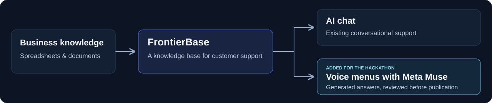
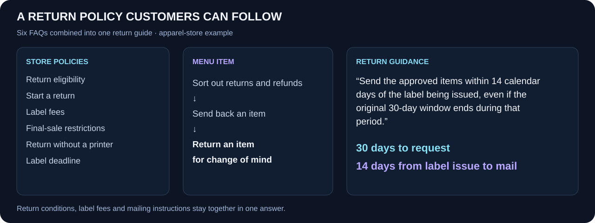
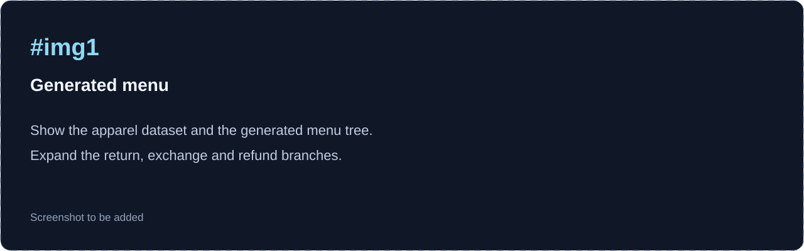
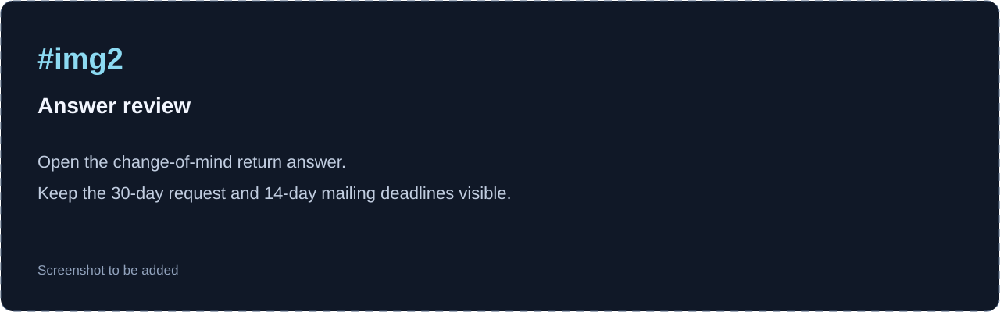
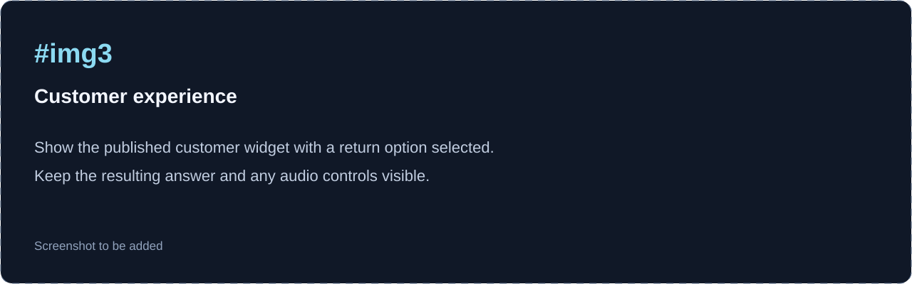
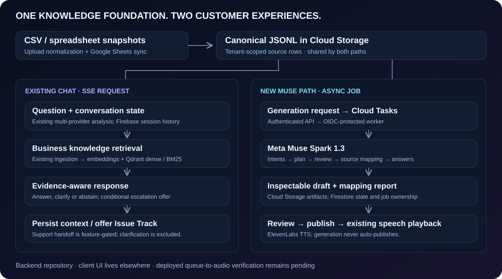

<h1> FrontierBase</h1>

**고객지원 스프레드시트를 음성 안내 메뉴로.**

Meta Muse가 FAQ를 음성 안내 메뉴로 구성하고, 메뉴 경로와 정책의 세부 조건을 검수한 뒤 담당자 검토 전에 초안을 교정합니다.

`Meta Muse Spark 1.3` · `콘솔: Vue 3` · `위젯: JavaScript (Vite)` · `Node.js 22` · `Firebase` · `ElevenLabs`

[웹사이트](https://www.frontierbase.io) · [사용 흐름](#사용-흐름) · [아키텍처](#시스템-아키텍처) · [검증 결과](#검증-결과) · [English](README.md)

**Meta Global AI Developer Hackathon 2026**

**FrontierBase는 기업의 스프레드시트와 문서를 AI 고객지원에 활용할 수 있는 지식 기반으로 만듭니다.**

## 고객이 따라 할 수 있는 반품 안내

**배송 완료 후 30일 이내**에 반품을 신청할 수 있는 쇼핑몰을 생각해 보세요.\
승인된 반품은 최초 신청 기간이 지났더라도 **라벨 발급일로부터 14일 이내에 발송**할 수 있습니다.\
두 기한을 모두 알아야 반품을 제대로 진행할 수 있습니다.

의류 쇼핑몰 예제에서 Muse는 반품 가능 조건, 신청 절차, 라벨 비용, 프린터가 없을 때의 방법, 발송 기한, 고객지원 방법을 담은 원본 7개 행을 하나의 반품 안내로 연결했습니다.\
오배송·파손, 제조 결함 의심, 반품 배송 추적 중단은 각각 별도의 메뉴로 구성했습니다.

최근 운영 실행에서는 **FAQ 60개를 상위 메뉴 6개와 답변 55개로 구성**해, **추출된 고객 의도 65개**를 모두 연결했습니다.\
각 의도는 하나의 주 메뉴에 배정하고, 안내에 필요한 정책은 여러 답변에서 함께 활용할 수 있습니다.

## 사용 흐름

**지식 연결 → 생성·검수 → 초안 검토 → 공개**

운영자가 고객지원 자료를 업로드하면 Muse가 메뉴를 구성하고, 경로와 답변을 검수한 뒤 발견한 문제를 교정합니다.\
담당자는 초안과 근거를 확인한 후 공개합니다. 고객은 전화 키패드에서 필요한 항목을 선택하고 공개된 안내를 듣습니다.

### #img1 — 생성된 메뉴

### #img2 — 답변 검토

### #img3 — 고객 화면

## 해결하려는 문제

소규모 사업장도 고객 문의에 대한 답을 스프레드시트와 문서에 정리해 두고 있습니다.\
하지만 음성 안내 메뉴를 만들려면 자료를 다시 읽고, 질문을 분류하고, 안내 문구를 작성하고, 예외 조건까지 확인해야 합니다.\
정책이 바뀔 때마다 메뉴도 다시 수정해야 합니다.

FrontierBase에서는 Muse가 초안 작성을 맡습니다.\
담당자는 각 답변의 원본을 확인하면서 무엇을 공개할지 결정합니다.

## 달라진 점

앞선 비교에서는 원본 62개 행으로 구성된 동일한 테스트 사례 5개에 기존 ARS 생성기와 Muse 파이프라인을 각각 실행했습니다.\
다음은 그 비교에서 관찰한 차이입니다.

| 사례 | 기존 ARS 생성기 | Muse 파이프라인 |
| :--- | :--- | :--- |
| 긴 정책 안에 포함된 환불 예외 | 보너스 크레딧 사용 후 적용되는 환불 제한을 누락했습니다. | 환불 안내에 해당 제한을 유지했습니다. |
| 이메일 변경과 영수증 다운로드를 함께 다루는 FAQ | 두 절차를 하나의 이메일 변경 메뉴에 넣었습니다. | 두 작업을 별도의 메뉴로 나눴습니다. |
| 같은 상품에 서로 다른 반품 기한이 제시된 경우 | 충돌 표시 없이 두 내용을 생성했습니다. | 두 기한을 함께 제시하고 담당자 검토가 필요한 답변으로 표시했습니다. |

기업은 고객의 목적에 맞춰 질문을 연결하고, 관련 정책의 세부 조건과 원본 근거를 확인할 수 있는 지원 흐름을 검토한 뒤 공개할 수 있습니다.\
이 비교는 선정된 사례에 한정되며, 위의 의류 쇼핑몰 예제와는 별개입니다.

## Meta AI 활용 방식

Muse Spark 1.3가 다섯 단계를 수행합니다.

1. **고객 의도 추출.** 고객의 목적, 현재 상황, 해결 방법과 필요한 정책 조건을 원본의 정확한 인용문과 함께 추출합니다.
2. **메뉴 설계.** 고객이 원하는 결과를 기준으로 문의를 묶고, 제안된 메뉴 경로를 검토합니다.
3. **근거 연결.** 각 의도에 하나의 주 메뉴를 배정합니다. 다른 행에 정의된 조건을 포함해 안내에 필요한 근거를 함께 연결합니다.
4. **답변 작성.** 관련 비용, 이용 조건, 기한과 예외를 유지해 음성 안내 문구를 작성합니다.
5. **검수·교정.** 별도의 Muse 호출로 메뉴 안내 문구만 보고 목적에 맞는 경로를 선택할 수 있는지 검사하고, 답변을 원본의 필수 조건과 대조합니다. 문제가 있는 항목을 교정한 뒤 다시 검수하며, 교정은 최대 두 차례 수행합니다.

Muse는 고객이 이용하기 전에 지원 흐름을 생성하고 검수합니다.\
FrontierBase는 원본 인용문과 검수 근거로 제시된 답변 발췌문을 검증하고, 근거를 함께 보관하며, 검토한 콘텐츠를 기존 음성지원 기능으로 공개합니다.\
고객은 키패드로 공개된 답변을 탐색합니다.

메뉴는 해당 기업의 자료를 바탕으로 생성됩니다.\
미리 정해 둔 쇼핑몰 카테고리 목록이나 행별 라우팅 규칙을 사용하지 않습니다.

## 공개 여부는 담당자가 결정합니다

각 답변은 작성에 사용된 정책과 연결됩니다.\
담당자는 문구를 확인하고 수정한 뒤 고객에게 제공할 준비가 됐는지 판단할 수 있습니다.

정책 충돌, 근거 누락, 해결되지 않은 검수 지적 사항은 초안에 표시되고 공개를 차단합니다.\
답변 문구를 수정하는 것만으로 메뉴 구조상의 경로 문제를 해제할 수는 없습니다. 해당 메뉴도 교정해야 합니다.\
생성 작업 완료는 초안이 준비됐다는 뜻이며, 공개까지 완료됐다는 뜻은 아닙니다.

## 시스템 아키텍처

관리 콘솔은 **Vue 3**, 고객용 위젯은 **JavaScript**로 작성했으며 **Vite**로 빌드합니다. 백엔드는 **Node.js 22와 Firebase**에서 실행하고, 메뉴 생성에는 **Muse**, 음성에는 **ElevenLabs**를 사용합니다.

메뉴 생성·검수·교정은 비공개 백그라운드 워커에서 실행하며, 운영자는 진행 상황을 확인할 수 있습니다.\
Cloud Storage는 초안과 근거 보고서를 저장하고, Firestore는 작업 소유권과 공개 상태를 관리합니다.\
초안과 공개된 콘텐츠는 분리됩니다. 음성 재생에는 기존 ElevenLabs 연동을 사용합니다.

## Meta Global AI Developer Hackathon에서 개발한 내용

| 기존 기반 | 해커톤에서 개발한 내용 |
| :--- | :--- |
| 스프레드시트 수집, Qdrant 검색, 대화 중 추가 확인과 상태 관리 | 별도의 Muse 생성 API와 비공개 워커 |
| ARS 프로토타입, 검토·공개·음성 기능 | 구조화된 의도 추출, 여러 행에 걸친 정책 연결, 원본 근거 기반 답변 |
| 테넌트 인증과 상담 이관 | 경로·답변 검수, 문제 범위에 한정한 교정, 공개 차단, 이전 작업의 뒤늦은 덮어쓰기 방지 |

프로젝트 이력: [FrontierBase 기존 기반 · 77c2d10](https://github.com/hadxits/frontierbase-meta-hackathon/commit/77c2d100a5d91dcbbb7816aa923b88f2375b3091) → [해커톤 초기 구현 · ccbcb3a](https://github.com/hadxits/frontierbase-meta-hackathon/commit/ccbcb3a86fe5f9e44a2b55b4686bc1dcbb631c31)

[Build for Your World](https://dev.meta.ai/events/global-hackathon)에서는 소규모 사업장이 이미 보유한 고객지원 지식을 실제로 활용하도록 돕는 문제에 집중했습니다.

## 검증 결과

**배포된 환경의 의류 쇼핑몰 실행 결과 · 2026년 10월 30일**

- **원본 60/60개 행 연결, 고객 의도 65개 배정.** 각 의도를 하나의 주 메뉴에 연결했습니다.
- **상위 메뉴 6개, 답변 메뉴 55개.** 관련 문의와 이를 뒷받침하는 정책은 적절한 경우 같은 메뉴에서 안내합니다.
- **최초 검수 지적 사항 10개 → 2개 → 0개.** 두 차례의 부분 교정 후 저장된 초안에 검토 필요 표시가 남지 않았습니다.
- **최종 Muse 검수에서 필수 사실 확인 항목 301개를 답변에 포함된 것으로 기록했습니다.** 여러 답변에서 재사용한 사실도 포함한 수치입니다. 기록된 원본 인용문과 최종 검수의 답변 발췌문은 모두 저장된 텍스트와 일치했습니다.
- 생성·검수·교정을 포함해 **18분 18초, Muse 호출 98회**가 소요됐습니다.
- 원본 연결의 누락 여부, 부분 교정, 검증 실패와 공개 차단을 다루는 **로컬 백엔드 회귀 테스트 65/65개를 통과**했습니다.

이 결과는 [합성 의류 쇼핑몰 데이터 60개 행](samples/online_apparel_store_cs_en.csv)을 배포된 환경에서 한 차례 실행한 기록입니다. 검수는 모델 기반이며, 이 수치가 독립적으로 측정한 정확도나 여러 업종의 성능을 의미하지는 않습니다.\
로컬 회귀 테스트는 모의 모델 응답을 사용합니다. 공개된 메뉴의 전체 음성 흐름은 추가 검증이 필요합니다.

## 주요 구현 파일

- [Muse 연동](cloud%20functions/utils/arsMuseLlm.js) — Meta 모델을 호출하고 응답을 검증합니다.
- [메뉴 생성](cloud%20functions/utils/arsMuseGenerator.js) — 문의를 구성하고 원본 근거를 연결해 답변을 작성합니다.
- [품질 검수·교정](cloud%20functions/utils/arsMuseQuality.js) — 경로와 원본의 필수 조건을 검수하고, 인용된 근거를 검증하며, 메뉴 수정 범위를 제한합니다.
- [초안 검토](cloud%20functions/endpoints/ai/updateArsLeafReview.js)와 [공개](cloud%20functions/endpoints/ai/publishArsMenu.js) — 담당자가 답변을 수정하고 검토 필요 항목을 해결한 후 공개할 수 있도록 합니다.
- [생성 작업 관리](cloud%20functions/utils/arsMuseJobs.js) — 백그라운드 작업을 관리하고 각 초안과 원본의 연결을 유지합니다.

## 다음 단계

공개된 메뉴의 전체 음성 흐름을 검증하고, 긴 음성 안내를 줄이며, 품질 검수를 유지하면서 생성 시간을 단축할 예정입니다.\
다른 업종의 데이터로도 평가가 필요합니다.\
장기적인 목표는 기업이 정책을 바꿀 때 고객지원도 그만큼 수월하게 갱신할 수 있도록 하는 것입니다.
