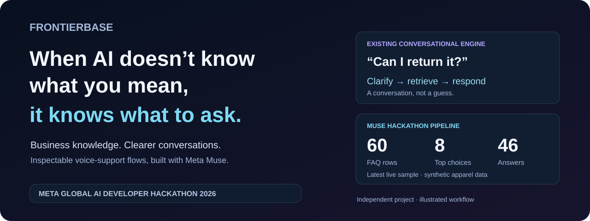
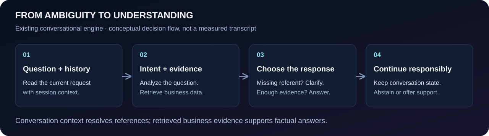

<div align="center">

# FrontierBase

Turn business spreadsheets into AI support that can clarify questions, retrieve trusted information, and deliver context-aware answers.



**Meta Global AI Developer Hackathon 2026 · Independent submission**

`Meta Muse Spark 1.3` · `Node.js 22` · `Firebase` · `Qdrant`

[Website](https://www.frontierbase.io) · [Product experience](#product-experience) · [Architecture](#system-architecture) · [Verified results](#measurable-intelligence) · [Source guide](#explore-the-implementation)

</div>

> **What is new?** FrontierBase already has conversational retrieval, clarification and escalation. This hackathon adds **Muse-generated voice-support flows**: customer-goal menus, source mappings and reviewable spoken answers. The existing chat path uses its existing model providers; Muse powers the new ARS generation path.

## Product Experience

**Connect business knowledge → understand the customer’s goal → deliver a grounded answer or guided voice flow.**

For the Muse-powered voice experience, an operator generates a draft from existing support knowledge, reviews source-linked answers, and approves publication. Customers navigate the resulting choices to hear relevant guidance.

## From Ambiguity to Understanding

**The important response is sometimes a question.**

> **Customer:** “Can I return it?”<br>
> **FrontierBase:** “Which product would you like to return?”<br>
> **Customer:** “The wireless earbuds I purchased yesterday.”<br>
> **FrontierBase:** “According to the return policy, unopened earbuds can be returned within seven days.”

*Illustrative dialogue with a fictional earbud policy—not a tested transcript or the apparel sample’s policy. The existing engine can request clarification; this exact follow-up and answer have not been validated.*



**The hackathon’s live-tested moment:** Muse transformed **60 FAQs into 8 top-level choices and 46 answer destinations**. Six source rows became one change-of-mind return destination covering eligibility, steps, fees and deadlines. The answer retained the critical exception: request within **30 days**, then mail within **14 days of label issue**, even if the initial window ends.

## The Problem

**Businesses already have the answers. Their AI still has to understand what to look for.**

Product catalogs, inventory, return policies and internal records often live in Excel or Google Sheets. A customer’s short question rarely names every product, condition or exception. An answer that sounds confident can still solve the wrong problem.

| Common failure pattern | Implemented FrontierBase response |
| :--- | :--- |
| Re-enter business knowledge manually | Canonical JSONL onboarding and Google Sheets synchronization |
| Guess an unspecified product or condition | Question semantics, conversation context and clarification fallback |
| Lose the previous turn | Bounded recent history plus stored conversation state |
| Retrieve only by matching words | Existing dense/BM25 retrieval and evidence selection |
| Produce an unsupported answer | Evidence-aware verification and clarify/abstain paths |
| Leave the customer at a dead end | Feature-gated Issue Track escalation with conversation context |
| Hand-author every voice menu | New Muse planning, evidence mapping and draft review |

*These are design comparisons, not benchmark claims about other products.*

## Intelligence Powered by Meta AI

**Muse Spark 1.3 turns business knowledge into an inspectable support structure.**

1. **Read:** full source rows → intents, conditions and exceptions.
2. **Design and review:** intents → a customer-goal hierarchy; one deeper review checks routes and parent scopes.
3. **Ground:** rows and planned destinations → mappings with verbatim quotes and topic indices.
4. **Compose:** all assigned evidence → spoken answers, covered source IDs and review reasons.

[The Meta caller](cloud%20functions/utils/arsMuseLlm.js) uses `https://api.meta.ai/v1`, strict JSON-schema output and `store: false`. Plan review uses `reasoning_effort: high`; other stages use `low`. Application code validates structure, coverage and quotes, permits one correction attempt, and rejects incomplete responses.

**Responsibility boundary:** Meta performs ARS reasoning and generation. FrontierBase handles access, retrieval infrastructure, validation, job ownership, review and publication. Conversational ambiguity detection, follow-up prompts and session memory remain in [the existing chat engine](cloud%20functions/endpoints/ai/streamChatRag.js), not the Muse caller.

[Meta protocol](https://dev.meta.ai/docs/protocols/chat-completions) · [Structured output](https://dev.meta.ai/docs/structured-output) · [Reasoning](https://dev.meta.ai/docs/reasoning)

## System Architecture


Chat streams responses over SSE. ARS generation returns a job ID, then runs through a private Cloud Tasks worker. Draft generation and publication are separate. Existing ElevenLabs integration supplies speech; no telephone-network integration is claimed.

## Engineering Beyond the Chatbot

<details>
<summary><strong>Inspect the decisions and simplified pseudocode</strong></summary>

**Clarification before guessing.** `shouldClarifyForMissingEvidence` combines semantic analysis with fallback signals. Recent context can resolve a reference; insufficient evidence can trigger clarification or abstention. The fallback question is generic and localized; model instructions can request a contextual follow-up. This behavior is conditional, not guaranteed for every ambiguous utterance.

**Context is not evidence.** Recent turns and stored state help interpret the request. The no-evidence path explicitly instructs the model not to treat conversation history or customer profiles as factual business evidence.

**Full-evidence menu generation.** Every extracted topic must map to a destination. Multiple topics in one row can support multiple menus. All assigned rows reach answer generation, batched and combined when needed. Empty destinations and detected conflicts retain review flags; publication blocks unresolved flags.

```python
# Conceptual pseudocode; the implementation is JavaScript.
rows = current_source_snapshot()
intents = muse.extract_intents(rows)
plan = muse.design_customer_goals(intents)
plan = muse.review_routes(plan, intents)
mapping = muse.assign_quotes(rows, intents, plan)
validate_topic_coverage_and_verbatim_quotes(mapping)

for leaf in plan.leaves:
    evidence = all_assigned_rows(mapping, leaf)
    if not evidence:
        flag_for_review(leaf)
        continue
    answer = muse.write_scoped_answer(leaf, evidence)
    validate_source_coverage_and_speech_length(answer)
    retain_review_reasons(leaf, answer, mapping)

save_draft_if_job_still_owns_current_source()
# Human review and publication happen separately.
```

**Failure handling.** Schema or semantic validation gets one correction attempt. Incomplete/refused output fails. Oversized spoken answers are corrected rather than silently sliced. Unique artifact names and transactional ownership checks prevent stale generation, review or publication from replacing a newer draft.

**Operational choices.** Batched ingestion, hybrid retrieval, bounded history and queued generation are implemented mechanisms—not measured throughput claims. Schema and exact-quote checks establish traceability; they do not prove every generated statement is correct.

</details>

## Built for the Meta Global AI Developer Hackathon

| Existing foundation | Hackathon contributions |
| :--- | :--- |
| Spreadsheet ingestion, Qdrant retrieval, conversational clarification and state | Separate Muse generation API and private worker |
| ARS prototype, review, publishing and speech | Customer-goal planning, plan review and full-evidence answers |
| Tenant authentication and support escalation | Source mapping reports, stale-write protections and local evaluation |

History anchors: [pre-existing baseline · 77c2d10](https://github.com/hadxits/frontierbase-meta-hackathon/commit/77c2d100a5d91dcbbb7816aa923b88f2375b3091) → [initial hackathon implementation · ccbcb3a](https://github.com/hadxits/frontierbase-meta-hackathon/commit/ccbcb3a86fe5f9e44a2b55b4686bc1dcbb631c31). Baseline code already contains clarification and escalation; the whole platform is not presented as new work.

The contribution fits our interpretation of [Build for Your World](https://dev.meta.ai/events/global-hackathon): apply Meta’s models to a familiar support problem and produce a flow a business can inspect before using.

## Measurable Intelligence

**Latest recorded live ARS run · October 28, 2026 · synthetic apparel data**

- **60/60 rows linked**, 8 top-level choices, 46 answer destinations.
- **14/14 targeted policy phrase checks passed** in answers linked to the relevant sources.
- **35/35 local regression tests passed** with mocked services: coverage, output correction, job ownership, access and concurrent review/publication.
- **270 seconds; 54 model responses** for that run—not a general latency or cost advantage.

Eight development attempts: seven completed; one hit a completion-token limit that was corrected. Configurations changed between attempts, so these are not repeatability trials. No measured chat intent accuracy or clarification-effectiveness benchmark is available. Long answers, pronunciation and deployed end-to-end behavior remain unverified.

## Explore the Implementation

<details>
<summary><strong>A short path through the backend</strong></summary>

- **Meta API:** [arsMuseLlm.js](cloud%20functions/utils/arsMuseLlm.js) — provider request, schema checks, correction and safe errors.
- **Menu intelligence:** [arsMuseGenerator.js](cloud%20functions/utils/arsMuseGenerator.js) — intents, hierarchy review, quotes and scoped answers.
- **Question understanding / clarification / context:** [streamChatRag.js](cloud%20functions/endpoints/ai/streamChatRag.js) — semantic analysis, missing-evidence decisions, history, state and answer verification.
- **Retrieval:** [qdrant.js](cloud%20functions/utils/qdrant.js) and [rag.js](cloud%20functions/utils/rag.js) — filtered dense/BM25 lookup and context assembly.
- **Business data:** [uploadDataset.js](cloud%20functions/endpoints/ai/uploadDataset.js), [syncGoogleSheetsDataset.js](cloud%20functions/endpoints/ai/syncGoogleSheetsDataset.js), [ingestCore.js](cloud%20functions/ingest/ingestCore.js) — normalized snapshots, Sheets sync and indexing. Raw Excel/CSV normalization is upstream of this upload endpoint.
- **Asynchronous jobs:** [arsMuseJobs.js](cloud%20functions/utils/arsMuseJobs.js) — private queue dispatch, source ownership and progress.
- **Escalation:** [ragHandlers.js](cloud%20functions/utils/ragHandlers.js) and [escalateSupportIssue.js](cloud%20functions/endpoints/support/escalateSupportIssue.js) — conditional offers and ticket creation; not a claim of live-agent chat.
- **Review / errors:** [arsDraft.js](cloud%20functions/utils/arsDraft.js), [publishArsMenu.js](cloud%20functions/endpoints/ai/publishArsMenu.js), [_onRequest.js](cloud%20functions/_onRequest.js) — stale-write checks, publication gates and request handling.

</details>

## AI Agents for Every Business

**Every business has knowledge. Every business deserves intelligent access to it.**

FrontierBase’s direction is practical: clarify what the customer needs, ground answers in business data, and turn repeated support knowledge into guided experiences. Next: shorter listening-tested answers, broader evaluation and a verified deployment. Policy updates should become reviewable improvements to support—not another menu to rebuild by hand.
