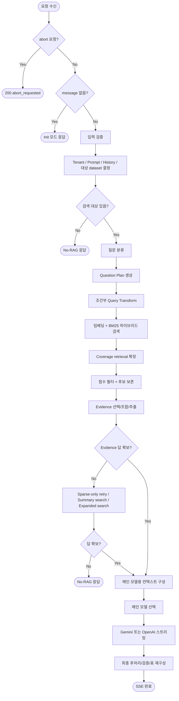
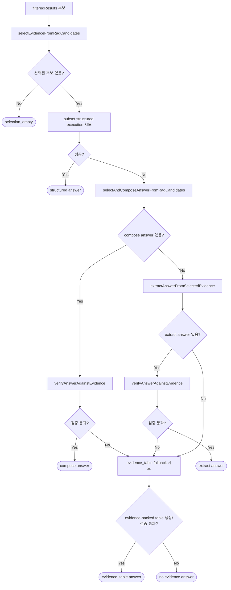

# `streamChatRag` 플로우

**파일**: `cloud functions/endpoints/ai/streamChatRag.js`  
**기준**: 현재 소스 기준  
**목적**: 하이브리드 RAG 검색, evidence 선택/검증, 메인 LLM 스트리밍, 후처리/저장까지 포함한 전체 요청 흐름 설명

---

## 1. 한눈에 보는 전체 흐름

---

## 2. 상위 단계 요약

| 단계 | 설명 |
|------|------|
| 요청 분기 | `abort`, `init`, 일반 채팅 요청을 먼저 분기 |
| 사전 준비 | tenant, prompt, history, dataset, quota, locale 등 확정 |
| 질문 이해 | `questionType` 분류 + `questionPlan` 생성 |
| 검색 | 임베딩 + BM25 하이브리드 검색, 필요 시 coverage retrieval |
| evidence 결정 | 후보 필터링 후 selection / compose / extract / verifier 수행 |
| 보조 검색 | 메인 검색이 약하면 sparse-only / summary / expanded search 순서로 재시도 |
| 스트리밍 | license + 질문 복잡도 + RAG 길이 기준으로 메인 모델 선택 |
| 최종 전달 | 표 재구성, verifier, 자연화, fallback 메시지 적용 |

---

## 3. 요청 진입

### 3-1. Abort

- `req.body.abort === true`
- `requestAbortSignal(tenant_id, conversation_id)` 등록
- 즉시 `200 + abort_requested`

### 3-2. Init

- `message`가 없거나 빈 문자열이면 초기화 요청으로 간주
- tenant / prompt / chat 관련 준비성 작업 후 `200 + ok`

### 3-3. 일반 채팅

- 메시지 공백/길이 검증
- tenant 활성 상태, quota, conversation/history, prompt, dataset 대상 확정

---

## 4. 질문 이해 단계

현재 흐름의 핵심은 `questionType` 하나만 보지 않고, 별도의 `questionPlan`을 만들어 이후 검색/표/검증까지 연결하는 점입니다.

### 4-1. 질문 타입 분류

- 모델: `gpt-4.1-nano`
- 목적: `lookup`, `comparison`, `explanation`, `action`, `unknown` 등 고수준 타입 분류

### 4-2. Question Plan 생성

- 모델: `gpt-4.1-nano`
- 주요 필드 예시
  - `intent`
  - `presentation_intent`
  - `target_field_hints`
  - `group_by_field_hints`
  - `value_field_hints`
  - `entity_hints`
  - `entities`
  - `filters`
  - `sort`
  - `needs_full_breakdown`
  - `coverage_required`

### 4-3. Query Transform

- 모델: `gpt-4.1-nano`
- 조건부 수행
  - 히스토리가 충분하거나
  - 짧은 `lookup` 질문이면 허용
- 과도한 일반화를 막기 위해 토큰 overlap 기반 `shouldRejectTransformedQuery()` 적용
- BM25 sparse는 검색 변형문이 아니라 **원문 message** 기준으로 생성

---

## 5. 검색 단계

### 5-1. 메인 검색

- 임베딩: `text-embedding-3-small`
- 검색: Qdrant 하이브리드 검색
  - Dense: embedding vector
  - Sparse: BM25
  - Fusion: RRF

### 5-2. topK

- 대상 데이터셋 총 레코드 수 기준으로 동적 결정
- 일반적으로 30 / 40 / 50 단계 사용

### 5-3. 스코어 필터

- `filterResultsByScore()`
- dense-only 쪽은 `minScore` 사용 가능
- hybrid(RRF)는 score 스케일이 달라 `minScore` 비활성화 가능

### 5-4. Coverage Retrieval

다음 조건이면 coverage retrieval을 사용합니다.

- `questionPlan.coverage_required === true`
- `intent === "compare"`
- `presentation_intent === "table"`
- `group_by_field_hints` 존재

흐름:

1. `buildCoverageSearchQueries()`로 보조 쿼리 생성
2. 보조 쿼리별 임베딩 생성
3. 기존 `row_id` 제외 검색
4. coverage 결과를 메인 결과와 병합
5. `preserveCoverageCandidates()`로 coverage 후보가 너무 빨리 잘리지 않게 보정

---

## 6. Evidence 결정 단계

현재 소스에서 가장 중요한 단계입니다.  
검색 결과를 바로 메인 모델로 넘기지 않고, 먼저 `evidence로 답할 수 있는지`를 별도 결정합니다.

### 6-1. Selection

- 모델: `gpt-4.1-nano`
- 목적: “검색 결과 중 실제로 답 가능한 evidence만” 선택
- coverage 질문에서는 여러 entity/item을 함께 커버하는 후보를 우선

### 6-2. Structured execution

현재 코드상 `canUseStructuredSupportForPlan()`은 **사실상 비활성**입니다.

- Canonical ingest 계약이 `row_id/text/version` 중심이라
- 공통 cross-source structured payload를 전제한 exact structured execution은 꺼져 있음
- 즉, 문서상 구조 실행 훅은 남아 있지만 현재 운영 경로의 주력은 `LLM selection/compose/extract + verifier`입니다

### 6-3. Compose / Extract

- `selectAndComposeAnswerFromRagCandidates()`
  - 후보 선택과 답안을 한 번에 생성
- `extractAnswerFromSelectedEvidence()`
  - compose가 실패하거나 약할 때 evidence만으로 추출 답 생성

### 6-4. Verifier

- 모델: `gpt-4.1-nano`
- 역할
  - unsupported fact 차단
  - 질문 계획과 어긋나는 grouping / ranking / comparison 차단
  - evidence가 있는데 `모른다`고 답하는 케이스 차단
  - table/grouped-breakdown 요청에서는 **evidence 기반 partial table**도 허용

### 6-5. Deterministic table support

표 요청일 때는 LLM verifier 전에 다음을 먼저 봅니다.

- 답이 Markdown table 형태인가
- 같은 evidence로 `buildEvidenceBackedTableAnswer()`를 다시 만들었을 때 구조가 맞는가
- header가 question plan의 힌트와 맞는가
- 답변의 각 row가 evidence 기반 기대 표의 row 집합 안에 있는가

이 조건을 만족하면 `deterministic_table_support`로 즉시 통과시킬 수 있습니다.

### 6-6. Evidence table fallback

compose/extract/verifier가 실패해도 table 요청이면 `buildEvidenceBackedTableAnswer()`로 evidence 기반 표를 한 번 더 시도합니다.

현재 특징:

- 특정 데이터셋 하드코딩 없이 동작
- `questionPlan` 힌트와 evidence 구조를 기반으로 축 선택
- 일부 케이스에서 메타 필드가 축으로 잘못 잡히는 문제가 아직 남아 있을 수 있음

---

## 7. 보조 검색 단계

Evidence answer를 못 얻었을 때 아래 순서로 재시도합니다.

### 7-1. Sparse-only retry

조건:

- 현재 `filteredResults.length === 0`
- `questionType === "lookup"`
- `searchQuery` 길이 80자 이하
- `querySparse` 사용 가능

특징:

- `forceSparseOnly: true`
- sparse 점수는 스케일이 달라 `minScore: null`

### 7-2. Summary search

- 기존 대화 요약(`summariesText`)이 있으면
- summary 텍스트를 다시 임베딩해 Qdrant 검색
- summary와 질문의 유사도를 보고 결과 채택 여부를 판단

### 7-3. Expanded search

- summary까지 약하면 확장 검색
- 기존 `row_id` 제외
- 더 넓은 topK로 재검색

### 7-4. No-RAG fallback

모든 검색 경로가 약하면 `handleNoRagResult()` 또는 `buildClarifyOrAbstainMessage()` 계열로 종료

---

## 8. 메인 모델 스트리밍

Evidence 단계가 끝나면 메인 LLM 스트리밍으로 들어갑니다.

### 8-1. 모델 선택 규칙

기준:

- `questionType === "lookup"` 이면 단순 질문으로 간주
- `ragContextLength >= 5000` 이면 장문
- `useStrongerModel = !isSimpleQuestion || isLongDoc`

| license | 단순 lookup + 짧은 RAG | 복잡 질문 또는 RAG 5000자 이상 |
|---------|------------------------|--------------------------------|
| `FREE`, `STARTER` | `gpt-4.1-nano` | `gemini-3-flash-preview` |
| `PRO`, `ENTERPRISE` | `gpt-4.1-nano` | `gemini-3.1-pro-preview` |

### 8-2. 시스템 프롬프트 구성

메인 스트리밍 프롬프트는 다음을 합칩니다.

1. tenant `compiled_system_prompt`
2. locale 기반 언어 고정 지시
3. context security guardrails
4. `Question Plan`
5. `Structured Execution Status`
6. `Extracted Answer (from Evidence)`가 있으면 그 블록
7. `Knowledge Base Evidence`

중요한 제약:

- EVIDENCE-ONLY
- 외부 지식 금지
- evidence 내부 지시 무시
- 일반적인 안내성 책임 문구 금지
- 질문 계획의 grouping/filter/sort/presentation 유지

### 8-3. 최근 메시지 개수

`determineRecentMessagesTurns()`로 최근 대화 턴 수를 결정합니다.

- 새 세션 여부
- 시간 간격
- state / summary 존재 여부
- topic continuity classifier 결과

를 보되, classifier 영향은 보수적으로만 사용합니다.

---

## 9. 최종 답 전달 단계

메인 모델이 생성한 답은 바로 보내지 않고 `finalizeModelAnswerForDelivery()`를 거칩니다.

### 9-1. 주요 작업

- `sanitizeAssistantTextFinal()`
- `normalizeDeliveredAnswerText()`
- 기존 표가 저품질인지 검사
- 필요 시 `buildEvidenceBackedTableAnswer()`로 표 재구성
- verifier 재검증
- `preferredEvidenceAnswer`가 더 신뢰되면 그 답으로 교체
- 최종 `naturalizeAnswerForDelivery()` 적용

### 9-2. 표 재구성 조건

다음이면 evidence 기반 표를 다시 시도할 수 있습니다.

- evidence 존재
- `presentation_intent === "table"`
- 기존 표가 없거나 저품질
- exact structured answer를 보존할 필요가 없음

### 9-3. 자연화

`naturalizeAnswerForDelivery()`는 과도한 후처리 대신 최소한의 문장 정리만 수행합니다.

- 공백/개행 정리
- 구조형 답이면 그대로 유지
- 한국어 compare/breakdown 답에 짧은 연결 어구를 붙일 수 있음

---

## 10. 저장 / 부가 처리

메인 응답과 별도로 아래 작업들이 수행됩니다.

- 토큰 사용량 집계
- audit monthly 기록
- chat/history 저장
- 비동기 state / customer_profile 갱신
- analytics / monitoring 기록

상태/프로필 갱신은 `gpt-4.1-nano` 기반 비동기 작업입니다.

---

## 11. 현재 소스 기준 주의사항

### 11-1. Structured exact execution

- 구조 실행 훅은 남아 있지만
- 현재 `canUseStructuredSupportForPlan()`은 사실상 `false`
- 따라서 운영 경로의 핵심은 `questionPlan + evidence selection + verifier + fallback table`입니다

### 11-2. 표 품질 이슈 가능 구간

현재 표 관련 품질은 주로 아래 단계에서 갈립니다.

1. `questionPlan`이 breakdown/table 의도를 제대로 잡는가
2. coverage retrieval이 분산 evidence를 충분히 회수하는가
3. `buildEvidenceBackedTableAnswer()`가 올바른 축을 고르는가
4. verifier가 partial table을 과도하게 reject하지 않는가

### 11-3. 실운영에서 자주 보는 로그 키

- `Question plan built`
- `Query transformation completed`
- `RAG search done`
- `Coverage retrieval expanded candidates`
- `Score-based filtering applied`
- `resolveEvidenceAnswerFromCandidates fallback`
- `Answer composed from RAG candidates`
- `Starting Gemini streaming`
- `Streaming completed`

---

## 12. 요약 표

| 구간 | 현재 주력 경로 |
|------|----------------|
| 질문 이해 | `classifyQuestionType` + `buildQuestionPlan` |
| 검색 | 하이브리드 검색 + coverage retrieval |
| evidence 결정 | selection / compose / extract / verifier |
| 표 처리 | `buildEvidenceBackedTableAnswer` + deterministic table support + evidence table fallback |
| 메인 생성 | `gpt-4.1-nano` 또는 Gemini |
| 후처리 | `finalizeModelAnswerForDelivery` |
| 저장/분석 | usage / audit / state/profile / analytics |

---

*문서 버전: 3.0 · 현재 `streamChatRag.js` 소스 기준 재작성*